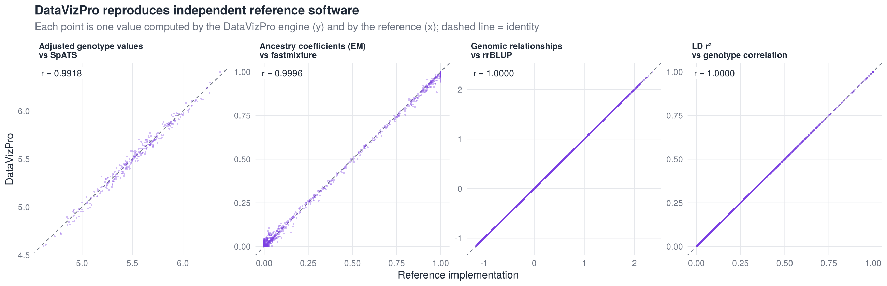
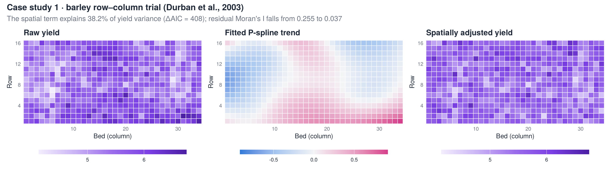
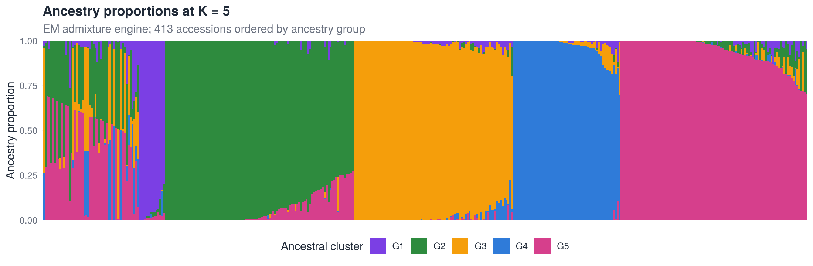
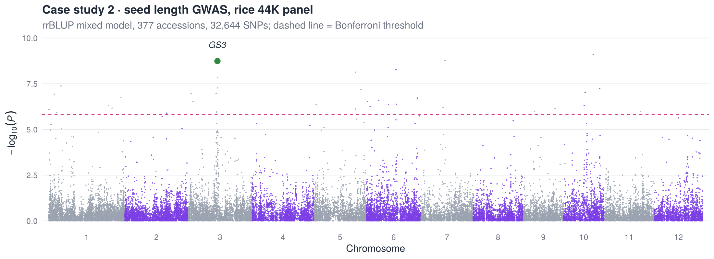
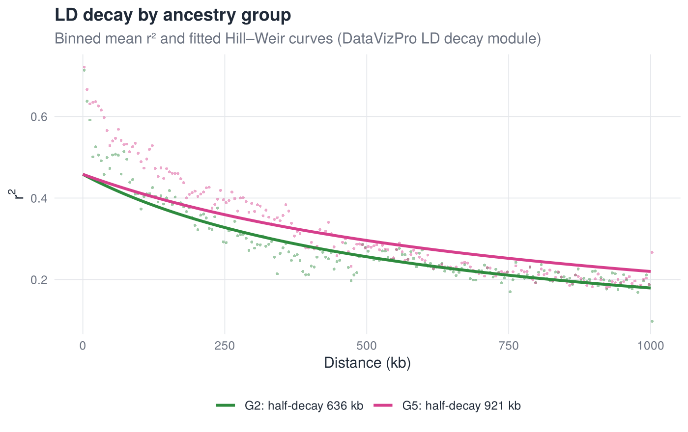
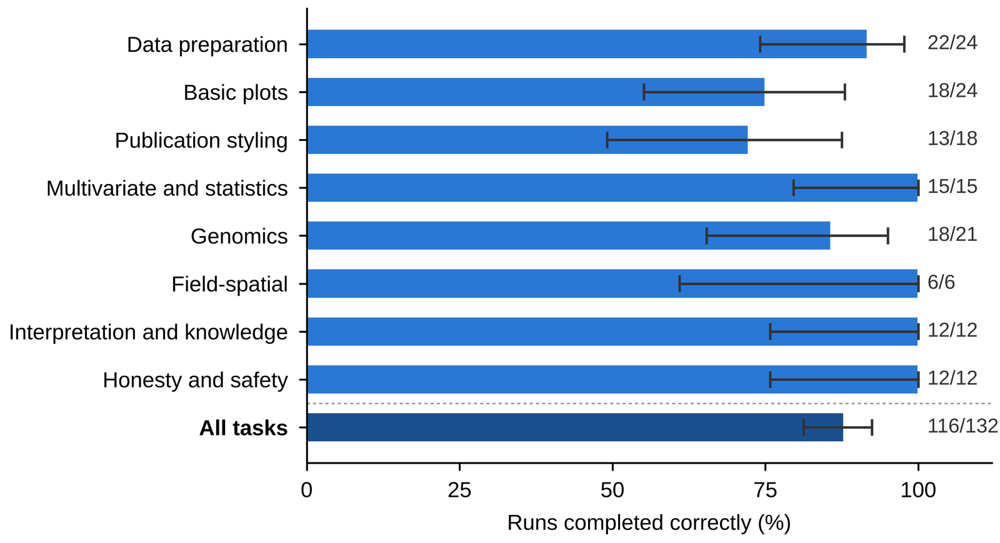
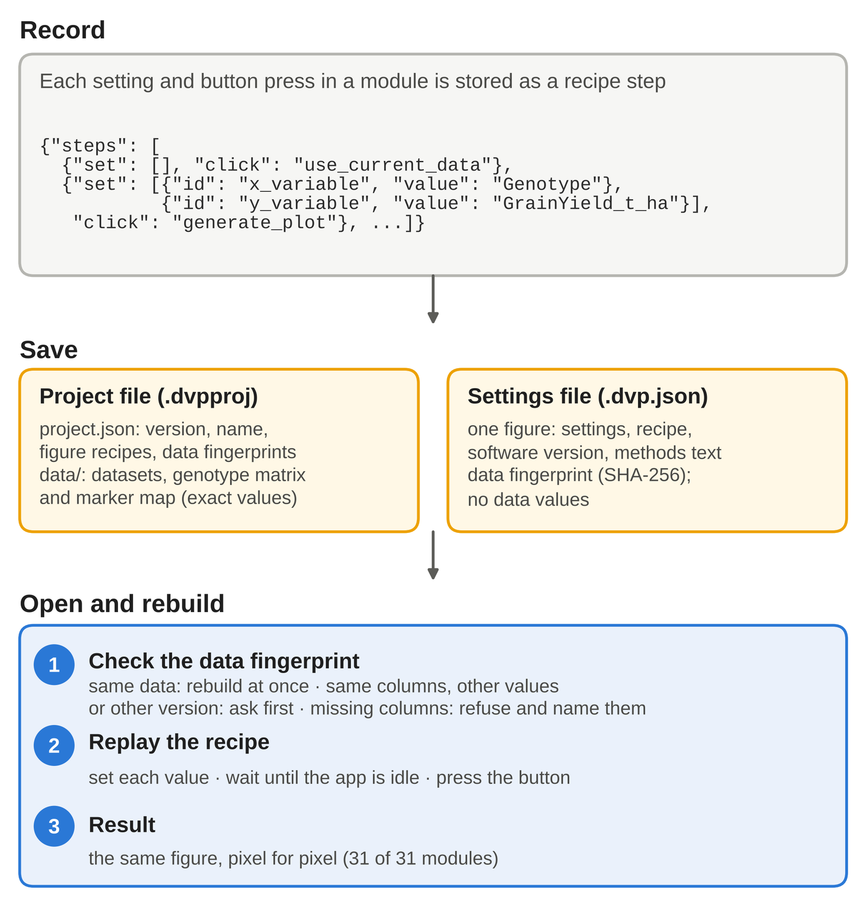

<p align="center">
  
</p>

<p align="center">
  <a href="https://app.plantnura.com"></a>
  <a href="https://plantnura.com/tools/datavizpro.html"></a>
  
</p>
<p align="center">
  
  
  
  
  
</p>

<h3 align="center">DataVizPro: an AI-assisted, no-code platform for visualization of crop phenotypic and genomic data</h3>
<p align="center"><b>Waseem Hussain</b> (<a href="https://orcid.org/0000-0002-6861-0193">ORCID</a>) and <b>Vinay Kumar Nandigam</b> · PlantNura Consulting &amp; Solutions LLP, Hyderabad, India</p>

---

This repository is the **companion to the DataVizPro article** (submitted to *Molecular Plant*). It contains the code, data and outputs behind the computed results in the paper:

- the agreement of DataVizPro with independent reference software, including Haploview 4.2 (**Supplemental Table 4**);
- the three case studies on public barley and rice data (**Figures 5 and 6**, **Supplemental Figure 5**);
- the **AskNura benchmark**: 44 tasks × 3 repeats, with the protocol and the score of every run (**Figure 3E**, **Supplemental Table 5**);
- the **settings files and example project** that rebuild the Figure 2 and 6F panels in the app (**Supplemental Data 1**).

The analyses are run with the **DataVizPro computation engine itself**. The functions that the app's modules call are copied verbatim from the application (v1.1.1; HaploView engine from v1.2) into [`dvp_engine/`](dvp_engine). Anyone can therefore regenerate the published numbers without an account, then check them in the web app at [app.plantnura.com](https://app.plantnura.com).

> **DataVizPro in one line.** 31 modules and 150+ plot types in seven families (distribution, comparative, relationship, multivariate, heatmap with field-spatial analysis, genomic visualisation, special plots). Data preparation, genotype QC, analysis and publication-grade figures, all in the browser, with no code and no installation.

## What is new in v1.2 (Molecular Plant version)

- **HaploView versus Haploview 4.2**: engine, comparison script and results ([details](#haploview-versus-haploview-42))
- **AskNura benchmark**: protocol, all 132 scored runs and the summary ([details](#asknura-benchmark))
- **Settings files and an example project** that rebuild the paper's figures in the app ([details](#settings-files-and-projects))
- New title, both authors, and the figure and table numbers of the submitted paper

## Contents

- [Highlights](#highlights)
- [Validation against reference software (Supplemental Table 4)](#validation-against-reference-software-supplemental-table-4)
- [HaploView versus Haploview 4.2](#haploview-versus-haploview-42)
- [Case studies](#case-studies)
- [AskNura benchmark](#asknura-benchmark)
- [Settings files and projects](#settings-files-and-projects)
- [Quick start](#quick-start)
- [Repository structure](#repository-structure)
- [From the paper to the code](#from-the-paper-to-the-code)
- [The DataVizPro engine extract](#the-datavizpro-engine-extract)
- [Data](#data)
- [Software environment](#software-environment)
- [Citation](#citation)
- [Licence and contact](#licence-and-contact)

## Highlights

| | |
|:--|:--|
| **8 / 8** | analyses agree with independent implementations, with Pearson *r* ≥ 0.992 |
| **817,281** | marker pairs: HaploView D′, *r*², LOD and D′ interval agree with Haploview 4.2; blocks identical |
| **116 / 132** | AskNura benchmark runs completed correctly (87.9 %); no invented feature, setting or number |
| **3 × 10⁻¹⁴** | largest difference between the DataVizPro relationship matrix and rrBLUP |
| **38.2 %** | of barley yield variance captured by the P-spline field trend (ΔAIC = 408) |
| **13 / 27** | top-10 % barley genotypes that stay in the top 10 % after spatial adjustment |
| **32,644** | rice SNPs × 413 accessions retained after DataVizPro genotype QC |
| ***GS3*** | seed-length association peak recovered on chromosome 3 (16.73 Mb) |

## Validation against reference software (Supplemental Table 4)

Each DataVizPro output was compared with an independent implementation on identical inputs, after identical quality control (call rate ≥ 0.8, MAF ≥ 0.05).

| Analysis | DataVizPro function | Reference | Dataset | Pearson *r* | Max. abs. difference |
|:--|:--|:--|:--|--:|--:|
| LD *r*² | `ld_compute()` | squared genotype correlation (PLINK `--r2` definition) | Rice 44K, chr 1 (500 SNPs; 124,748 pairs) | 1.000000 | < 10⁻¹⁵ |
| LD *r*² | `ld_compute()` | snpStats 1.62 (EM haplotype *r*²) | same | 0.99987 | 0.28 ¹ |
| LD *D*′ | `ld_compute(…, "dprime")` | snpStats 1.62 (EM *D*′) | same | 1.000000 | 1.6 × 10⁻¹⁰ |
| LD decay (half-decay distance) | `ldd_make_entry()` | independent least-squares Hill–Weir fit | Rice 44K, 2 ancestry groups | — | 0.0001 kb |
| Ancestry coefficients, EM engine | `ps_run_parametric_admixture()` | fastmixture 1.3 (ADMIXTURE model) | Rice 44K, *K* = 5 | 0.99958 | 0.094 |
| Ancestry coefficients, sNMF engine | `ps_run_snmf()` | fastmixture 1.3 (ADMIXTURE model) | Rice 44K, *K* = 5 | 0.99813 | 0.21 |
| Genomic relationship matrix | `gh_kinship()` | VanRaden formula (base R); rrBLUP 4.6 | Rice 44K (85,078 pairs) | 1.000000 | 3.2 × 10⁻¹⁴ |
| PCA scores | `compute_pca()` | `prcomp` (base R) | Rice phenotypes (359 × 18) | 1.000000 | 0.009 ² |
| Regression coefficients | `fit_regression_model()` | statsmodels 0.15 (OLS, logistic) | Rice phenotypes | 1.000000 | 7.6 × 10⁻¹² |
| Spatially adjusted genotype values | `fs_fit_trend()` | SpATS 1.0 (PSANOVA) | Barley trial (272 genotypes) | 0.99178 | 0.14 ³ |
| HaploView D′, *r*², LOD, D′ interval | `hv_ld_engine()` | Haploview 4.2 | 747 lines × 1,279 markers, one chromosome (817,281 pairs; max. distance 500 kb) | — | within Haploview's printed rounding |
| HaploView haplotype blocks | `hv_blocks_gabriel()` · `hv_blocks_spine()` · `hv_blocks_4gamete()` | Haploview 4.2 (default settings) | same | — | identical: 184/184 (confidence intervals), 361/361 (solid spine), 329/329 (four-gamete) |

<sub>¹ DataVizPro reports composite (genotype-correlation) *r*², which is the PLINK definition. snpStats estimates haplotype *r*² by EM, and the two estimators legitimately differ only for pairs involving heterozygous or missing calls. ² FactoMineR standardises with 1/*n*, `prcomp` with 1/(*n* − 1). ³ The spline bases differ: mgcv uses a 10 × 10 tensor-product P-spline, SpATS PSANOVA uses 17 × 8 segments. Replicates are random in DataVizPro and fixed in SpATS. Spearman rank correlation = 0.989.</sub>

<p align="center"></p>

The full table, with *n* for each comparison, is in [`results/tables/table4_agreement.csv`](results/tables/table4_agreement.csv) (Supplemental Table 4 of the paper).

## HaploView versus Haploview 4.2

The HaploView module computes two-locus haplotype frequencies by EM for every marker pair and from them D′, *r*², the LOD score and the likelihood interval of D′, as Haploview 4.2 does, and defines blocks with Haploview's three methods and default settings. The engine is [`dvp_engine/haploview.R`](dvp_engine/haploview.R).

The comparison reported in the paper (747 lines × 1,279 markers of one chromosome) is summarised in the table above. [`scripts/11_haploview.R`](scripts/11_haploview.R) repeats the same comparison on public data, chromosome 4 of the rice 44K panel (413 lines × 2,519 markers after QC):

1. `Rscript scripts/11_haploview.R` writes the Haploview input (`results/haploview/rice_chr4.ped`, `.info`) and the DataVizPro results (pairwise statistics and the three block sets).
2. Run Haploview 4.2 on the same input (the command is in the script header).
3. Run the script again: it compares every pair and every block and adds the rows to `table4_agreement.csv`.

## Case studies

### 1 · Spatial analysis of a barley field trial

The data are the row–column trial of Durban et al. (2003): 272 genotypes × 2 replicates on a 16 × 34 grid. The model has genotype fixed, replicate random and a tensor-product P-spline surface.

<p align="center"></p>

| Result | Value |
|:--|--:|
| Spatial variance share | 38.2 % |
| ΔAIC (no-spatial − spatial model) | 408.4 |
| Moran's *I* of residuals: design only → design + spatial | 0.255 (*P* < 10⁻¹⁶) → 0.037 (*P* = 0.19) |
| LISA plots significant at FDR 0.05: before → after adjustment | 1 → 0 |
| Spherical semivariogram: nugget / partial sill / range | 0.046 / 0.021 / ≈ 10 plots |
| Spearman correlation, raw vs adjusted genotype means | 0.863 |
| Top-10 % genotypes retained after adjustment | 13 of 27 |

Outputs are in [`case1_barley_summary.csv`](results/tables/case1_barley_summary.csv), [`case1_barley_genotypes.csv`](results/tables/case1_barley_genotypes.csv) and [`case1_barley_variograms.csv`](results/tables/case1_barley_variograms.csv).

### 2 · Genomic characterisation of the rice 44K diversity panel

The data are the panel of Zhao et al. (2011): 413 accessions and 36,901 SNPs, of which 32,644 SNPs remain after QC.

<p align="center"></p>

- **Population structure.** Genotypic PC1 and PC2 explain 36.5 % and 10.4 % of the variance. sNMF cross-entropy falls steeply up to *K* = 4 with no clear minimum. At *K* = 5, 361 accessions (87 %) have a dominant ancestry coefficient ≥ 0.7. They form five groups (G1–G5: 14, 102, 86, 58 and 101 accessions), and 52 accessions are admixed.
- **Kinship.** The mean VanRaden relationship is 1.14 within groups and −0.36 between groups.
- **LD decay.** The fitted Hill–Weir curve falls to half its initial value at 636 kb in G2 and 921 kb in G5 (pairs up to 1 Mb; the app figure in the paper uses pairs up to 500 kb, giving about 600 kb and 1.17 Mb).
- **GWAS** (rrBLUP mixed model, kinship + 3 PCs). For **seed length**, 36 SNPs on 9 chromosomes pass the Bonferroni threshold. One of the strongest signals lies at ***GS3*** (chromosome 3, 16.73 Mb). For **flowering time** (Arkansas), one SNP on chromosome 6 (9.65 Mb) passes, about 0.3 Mb from ***Hd1***. Inflation factors are λ = 0.93 and 0.85.

<p align="center">
  
  
</p>

### 3 · Multi-trait phenotypic relationships

The data are 18 agronomic, grain and quality traits of the same panel; 359 accessions have complete records.

- **Correlations.** 109 of 153 trait pairs are significant after Benjamini–Hochberg adjustment. The strongest are seed length vs brown-rice seed length (*r* = 0.977, 95 % bootstrap CI 0.972–0.982), seed volume vs surface area (0.909) and seeds vs florets per panicle (0.899).
- **PCA.** PC1 (25.3 %) reflects panicle size and phenology, and PC2 (19.5 %) reflects grain size and panicle number. Ancestry groups explain 32 % and 43 % of their variance.
- **Clustering.** The traits form five clusters (cophenetic *r* = 0.82). The smaller of two accession clusters is mostly ancestry group G2.

## AskNura benchmark

AskNura is the AI agent in DataVizPro (built on Anthropic's Claude models). It operates the app's own controls after the user approves its plan; every number comes from the app, not the model. It was tested on **44 tasks in eight categories × 3 repeats = 132 runs**, each in a fresh session on the live service (v1.2).

| Measure | Result |
|:--|:--|
| Completed and correct | 116 / 132 = 87.9 % (95 % Wilson CI 81.2–92.4 %) |
| Partial · failed | 10 · 6 |
| Invented feature, setting or number | 0 / 132 |
| Median time per task | 66.5 s |
| Cost | at most US$0.13 per task |

<p align="center"></p>

| File | Content |
|:--|:--|
| [`asknura_benchmark/AskNura_Benchmark_Protocol.md`](asknura_benchmark/AskNura_Benchmark_Protocol.md) | set-up, scoring rules and the 44 tasks with their checks |
| [`asknura_benchmark/AskNura_benchmark_scores_all.csv`](asknura_benchmark/AskNura_benchmark_scores_all.csv) | one row per run: time, approvals, steps, outcome, correct, invented, notes |
| [`asknura_benchmark/AskNura_benchmark_summary.md`](asknura_benchmark/AskNura_benchmark_summary.md) | summary by category and the recurring partial or failed cases |
| [`asknura_benchmark/Supplemental_Table5_runs.xlsx`](asknura_benchmark/Supplemental_Table5_runs.xlsx) | Supplemental Table 5 of the paper |

## Settings files and projects

A **settings file** (`.dvp.json`) holds the recipe of one figure (every setting and button press) with a data fingerprint and no data values. A **project file** (`.dvpproj`) holds the datasets and the recipe of every figure. Opening either in DataVizPro (*Project → Open*) rebuilds the figure.

<p align="center"></p>

In the paper, figures of all 31 modules were rebuilt pixel for pixel after saving, reopening the project in a new session and replaying (Figure 4C).

| File | Rebuilds |
|:--|:--|
| [`settings_and_projects/Fig2A_boxplot.dvp.json`](settings_and_projects/Fig2A_boxplot.dvp.json) | Figure 2A, box plot of the RCBD trial |
| [`settings_and_projects/Fig2C_heatmap.dvp.json`](settings_and_projects/Fig2C_heatmap.dvp.json) | Figure 2C, clustering heatmap |
| [`settings_and_projects/Fig2D_haploview.dvp.json`](settings_and_projects/Fig2D_haploview.dvp.json) | Figure 2D, HaploView figure |
| [`settings_and_projects/Fig6F_circular_manhattan.dvp.json`](settings_and_projects/Fig6F_circular_manhattan.dvp.json) | Figure 6F, circular Manhattan plot |
| [`settings_and_projects/example_project.dvpproj`](settings_and_projects/example_project.dvpproj) | the project of Figure 4A (RCBD dataset, box plot, histogram, Circos plot) |

## Quick start

```bash
git clone https://github.com/whussain2/DataVizPro_Validation.git
cd DataVizPro_Validation

# 1. R packages (R >= 4.5)
Rscript install_packages.R

# 2. Python references (fastmixture and statsmodels)
pip install -r python/requirements.txt

# 3. Everything: Supplemental Table 4, case studies, figures (about 30 min on 2 cores)
Rscript run_all.R
```

Each step can also be run on its own from the repository root, for example `Rscript scripts/01_barley_spatial.R`. The scripts call the Python references automatically when `python3` and `fastmixture` are on the PATH. Otherwise, run `python python/references.py` after `02_rice_qc.R` and `09_phenotypes.R`.

## Repository structure

```text
DataVizPro_Validation/
├── run_all.R                  # runs scripts 01-11 in order
├── install_packages.R         # CRAN + Bioconductor dependencies
├── dvp_engine/                # DataVizPro computation functions (verbatim extract)
│   ├── load_engine.R
│   ├── fieldspatial.R         # field-spatial P-spline model, Moran's I, LISA, variograms
│   ├── ps_io.R · ps_inference.R   # genotype QC, EM / sNMF ancestry, PCA
│   ├── ld_heatmap.R · ld_decay.R  # pairwise LD (r2, D'), LD decay models
│   ├── genomics_heatmap.R     # genomic relationship matrices
│   ├── pca.R · pca_helpers.R  # PCA (FactoMineR)
│   ├── correlation.R · regression.R
│   └── haploview.R            # Haploview 4.2 statistics and blocks (v1.2)
├── scripts/
│   ├── 00_setup.R             # paths, engine loader, helpers
│   ├── 01_barley_spatial.R    # case study 1 + SpATS
│   ├── 02_rice_qc.R           # genotype QC
│   ├── 03_ancestry.R          # EM + sNMF vs fastmixture
│   ├── 04_kinship.R           # VanRaden vs formula and rrBLUP
│   ├── 05_genotype_pca.R
│   ├── 06_ld_heatmap.R        # r2 / D' vs snpStats
│   ├── 07_ld_decay.R          # Hill-Weir vs independent fit
│   ├── 08_gwas.R              # rrBLUP GWAS (seed length, flowering time)
│   ├── 09_phenotypes.R        # case study 3 + PCA + regression checks
│   ├── 10_figures.R           # figures in results/figures
│   └── 11_haploview.R         # HaploView vs Haploview 4.2
├── python/
│   ├── references.py          # fastmixture and statsmodels references
│   └── requirements.txt
├── data/                      # public datasets (see data/README.md)
│   ├── barley/Durban2003Barley.csv
│   └── rice/Geno44k.txt · sativas413.map · sativas413.fam · rice_phenotypes.csv
├── results/
│   ├── tables/                # every number reported in the paper, as CSV
│   ├── figures/               # figures shown above
│   └── sessionInfo.txt
├── asknura_benchmark/          # protocol, per-run scores, summary (Supplemental Table 5)
├── settings_and_projects/      # .dvp.json settings files and an example .dvpproj (Supplemental Data 1)
├── assets/                    # banner and logos
├── CITATION.cff
└── LICENSE
```

## From the paper to the code

| Manuscript | Script or folder | Output |
|:--|:--|:--|
| Supplemental Table 4, SpATS row · Figure 5 | `01_barley_spatial.R` | `case1_barley_*.csv`, `fig_barley_spatial.png` |
| Case study 2: QC | `02_rice_qc.R` | `case2_rice_qc.csv` |
| Supplemental Table 4, ancestry rows · Figure 6D | `03_ancestry.R` | `case2_rice_ancestry_K5.csv`, `case2_rice_snmf_cross_entropy.csv`, `fig_ancestry_K5.png` |
| Supplemental Table 4, relationship matrix · Figure 6B | `04_kinship.R` | `case2_rice_kinship.csv` |
| Case study 2: PCA · Figure 6C | `05_genotype_pca.R` | `case2_rice_genotype_pca.csv` |
| Supplemental Table 4, LD rows | `06_ld_heatmap.R` | `table4_agreement.csv` |
| Supplemental Table 4, LD decay · Figure 6E | `07_ld_decay.R` | `case2_rice_ld_decay.csv`, `fig_ld_decay.png` |
| Case study 2: GWAS · Figure 6F | `08_gwas.R` | `case2_rice_gwas_summary.csv`, `case2_rice_gwas_loci.csv`, `fig_manhattan_seed_length.png` |
| Supplemental Table 4, PCA and regression · Supplemental Figure 5 | `09_phenotypes.R` | `case3_*.csv` |
| Supplemental Table 4, Haploview 4.2 rows | `11_haploview.R` | `results/haploview/`, `table4_agreement.csv` |
| Figure 3E · Supplemental Table 5 | `asknura_benchmark/` | per-run scores and summary |
| Figure 2 · Figure 4 · Supplemental Data 1 | `settings_and_projects/` | settings files and example project |

## The DataVizPro engine extract

[`dvp_engine/`](dvp_engine) holds the computation functions behind the DataVizPro modules used in the paper, **copied verbatim** from the application source (v1.1.1, commit `af537d9`; `haploview.R` from v1.2). The scripts call exactly the code that runs when a user clicks *Run* in the app.

- **What is included:** the analysis functions and their internal helpers, including the HaploView engine.
- **What is not included:** the user interface, the settings-driven figure engine, AskNura, plan and account handling, and anything else from the web application. DataVizPro itself is available at [app.plantnura.com](https://app.plantnura.com), and reviewers and editors can get temporary full access on request.

## Data

All datasets are public and included in [`data/`](data) with their sources and licences ([`data/README.md`](data/README.md)):

- **Barley:** Durban et al. (2003), *J. Agric. Biol. Environ. Stat.* 8, 48–66, via the R package agridat.
- **Rice 44K:** Zhao et al. (2011), *Nat. Commun.* 2, 467 ([ricediversity.org](http://www.ricediversity.org/data/)). The phenotypes are the version redistributed in the R package enhancer.

## Software environment

| Component | Version used |
|:--|:--|
| R | 4.6.1 (application: 4.5.3) |
| mgcv · spdep · gstat | 1.9-1 · 1.4-2 · 2.1-6 |
| SpATS · LEA · snpStats | 1.0-20 · 3.24.0 · 1.62.0 |
| rrBLUP · FactoMineR · clue | 4.6.3 · 2.18 · 0.3-68 |
| fastmixture · statsmodels (Python) | 1.3.0 · 0.15.0 |

The full session information is in [`results/sessionInfo.txt`](results/sessionInfo.txt). The results are deterministic: random steps use fixed seeds (EM and sNMF: 42; fastmixture: 1–5; bootstrap: 1).

## Citation

If you use DataVizPro, these scripts or the results, please cite:

```bibtex
@article{hussain2026datavizpro,
  author  = {Hussain, Waseem and Nandigam, Vinay Kumar},
  title   = {{DataVizPro}: an {AI}-assisted, no-code platform for visualization of
             crop phenotypic and genomic data},
  journal = {Molecular Plant},
  year    = {2026},
  note    = {Submitted}
}

@software{hussain2026datavizpro_app,
  author    = {Hussain, Waseem},
  title     = {{DataViz Pro}: publication-ready data visualization for plant science},
  version   = {1.2},
  year      = {2026},
  publisher = {PlantNura Consulting \& Solutions LLP},
  url       = {https://plantnura.com/tools/datavizpro.html}
}
```

GitHub's *Cite this repository* button uses [`CITATION.cff`](CITATION.cff).

## Licence and contact

The scripts, the engine extract and the documentation are released under the [MIT licence](LICENSE). The datasets keep the terms of their original sources. The DataVizPro web application, its interface and its trademarks are not covered by this licence.

Questions and reproducibility issues: please open an [issue](https://github.com/whussain2/DataVizPro_Validation/issues) or write to **waseemhussain@plantnura.com**.

<p align="center">
  <a href="https://plantnura.com"></a>
</p>
<p align="center"><sub>© 2026 PlantNura Consulting &amp; Solutions LLP · Hyderabad, India</sub></p>
